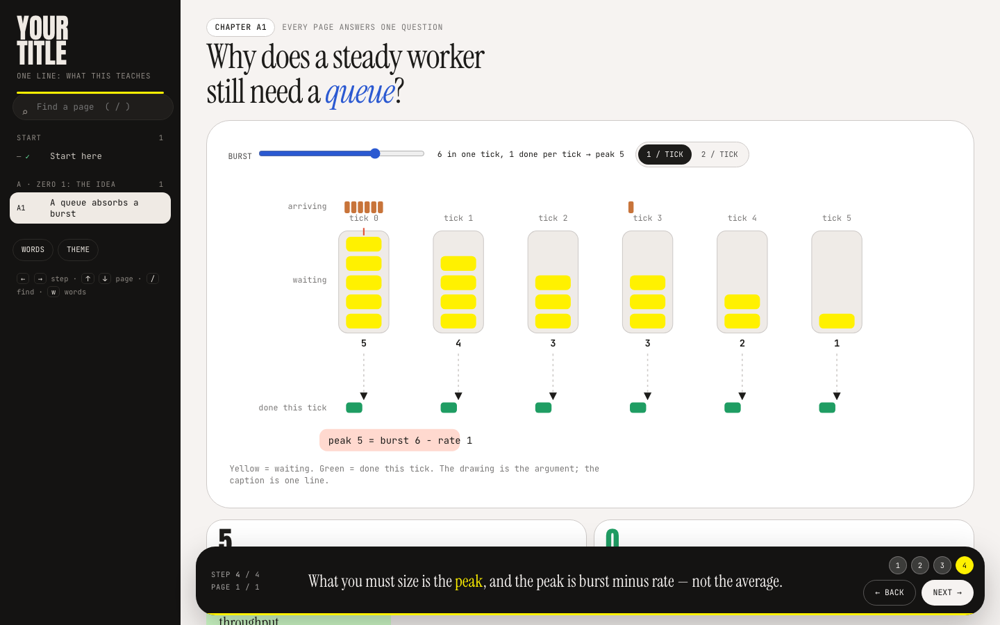
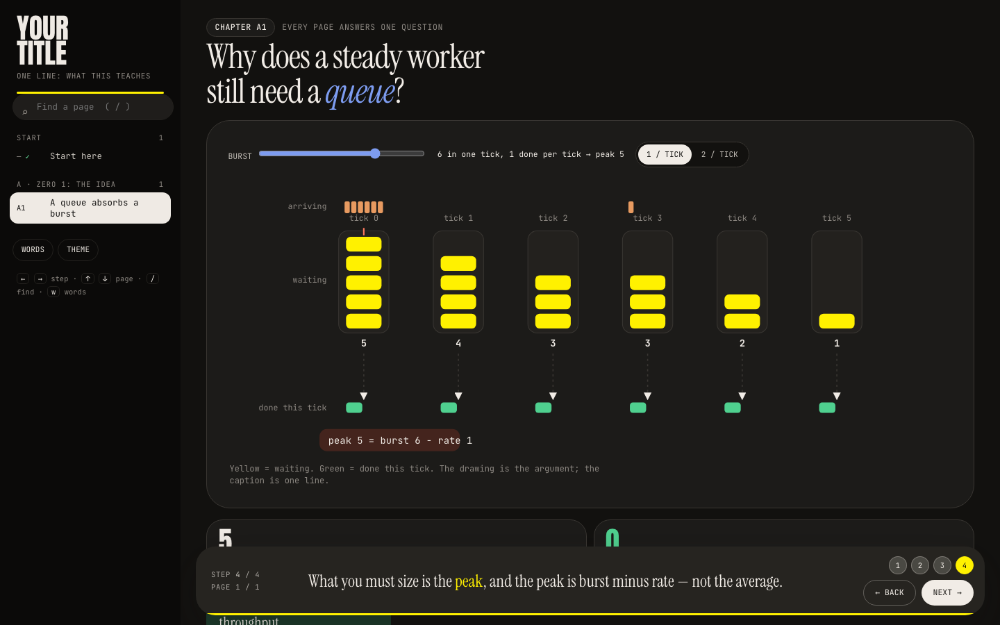

# Visual explainer — an agent skill

Give this folder to your coding agent and ask it to explain anything. You get back a single
self-contained HTML page: chapters in a rail, one question per page, an interactive drawing that
answers it, and narration that advances one idea at a time — light and dark, desktop and phone.




It is the style of [lpulite-explained.vercel.app](https://lpulite-explained.vercel.app), packaged so
your agent can build its own. The kit here is the real engine from that site, not a description of it.

## Install

**Claude Code** — copy the folder into your skills directory:
```bash
git clone https://github.com/Prahaladha-Reddy/lpulite-explained /tmp/lpux
mkdir -p ~/.claude/skills && cp -R /tmp/lpux/skills/visual-explainer ~/.claude/skills/
```
Restart Claude Code. Then just ask:
> Build me a visual explainer on how HTTPS actually works, from zero.

It also works per-project: put it in `<repo>/.claude/skills/visual-explainer/`.

**Any other agent** (Cursor, Codex, Copilot, a plain chat) — point it at `SKILL.md` and the `kit/`
folder: "follow these instructions and this starter kit". The kit needs nothing but Python 3, Node
(for the checks) and a browser.

## What's inside

| Path | What it is |
|---|---|
| `SKILL.md` | the instructions the agent follows: the ten rules, the workflow, the page and figure contracts, the gates |
| `kit/head.html` | the design system — colour tokens for light **and** dark, typography, every component's CSS |
| `kit/shell.js` | router, chapter rail, step reveal, narration bar, search, theme toggle, runtime contrast guard |
| `kit/helpers.js` | the SVG drawing API the figures are written against |
| `kit/build.sh` | concatenates everything into one `dist/index.html`; checks JS and missing element ids |
| `kit/qa.js`, `kit/contrast.js` | the two checks that must be clean before shipping |
| `kit/pA_demo.html` + `kit/fA_demo.js` | a working chapter to copy — the demo in the screenshots |
| `references/` | method (how to choose chapters), design (tokens and components), diagrams (patterns), checklist (ship + deploy) |

## Try the demo in 30 seconds
```bash
cd skills/visual-explainer/kit && bash build.sh && open dist/index.html
```

## Why it works
No framework, no build step, no dependencies — one HTML file you can email, host anywhere or open
offline. The reader clicks instead of reading, the conclusion is always stated outright, and colour
means the same thing on every page: green better, red worse, yellow moving now.

Licensed the same as the rest of this repository.
